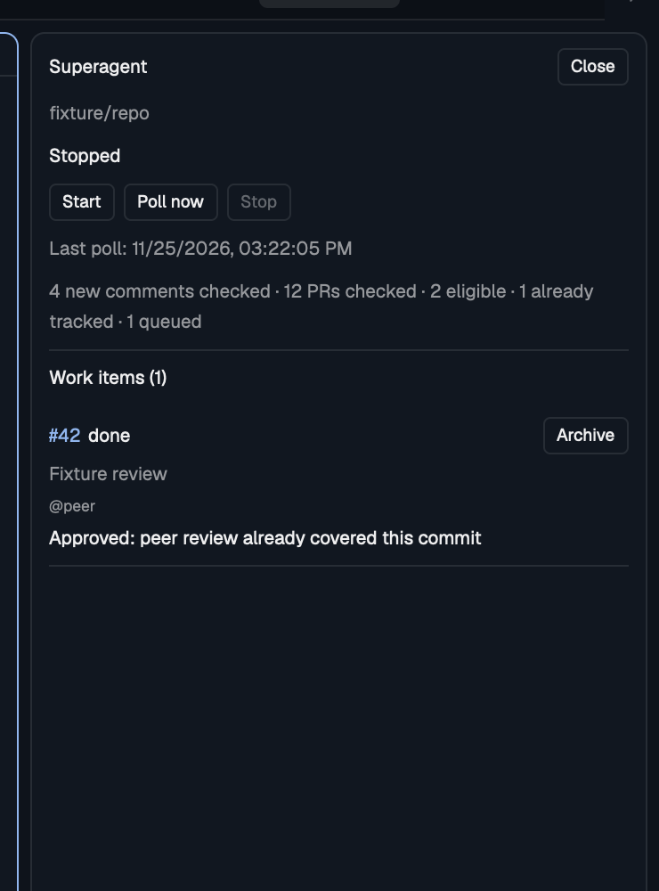

# Herdr Pi Superagent

A Herdr layout with a top-bar button and docked Superagent sidebar. See [RECIPE.md](RECIPE.md) for the layout and its behavior.

## Install

1. Read the layout and mod files before installing. Copy `layouts/superagent.json` and the two `mods/` folders into the matching directories under `~/.config/herdr-app`. If a name is already taken, rename the incoming files and update their references rather than overwriting a local mod.
2. Run `herdr-app check` on each installed mod, then switch to `superagent` in Herdr's layout picker.
3. Install the included [Pi Superagent](https://github.com/aicodewith-team/pi-superagent) package with its Herdr bridge: run `npm ci` inside `pi-extension/`, then run `pi install ./pi-extension` from this repository. If you already have another Pi Superagent package enabled, disable that copy first to avoid duplicate slash commands.
4. In the repository you want to manage, configure `.pi/superagent.yml` from [`pi-extension/examples/superagent.yml`](pi-extension/examples/superagent.yml). Use a dedicated GitHub account and start with `dryRun: true`. In a local Herdr Pi terminal, run `/superagent` once. Use the header button for the rest.

The mod calls local `curl` over a private Unix socket. It does not start GitHub work on its own. Starting the watcher or running a work item can publish to GitHub when dry-run is off. Closing Pi stops its watcher.

The included extension retains the upstream [MIT license](pi-extension/LICENSE).
