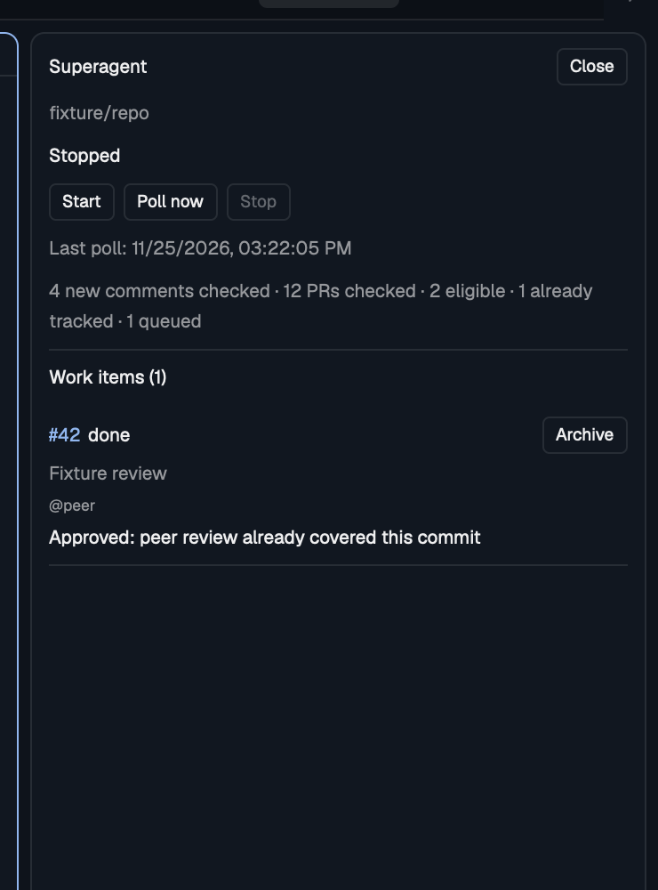

# Superagent for Herdr

A compact Superagent button joins the top bar when Pi is connected. It opens a docked right sidebar where you can check GitHub poll results and manage individual work items without leaving your terminal. The preview shows the sidebar with fictional data.

## What you see

- Keep Herdr's standard spaces, agents, terminal tabs, main terminal area, Files, Changes, and status bar. The header has a 118 px slot at the right edge. Its 26 px Superagent button uses the same chrome and selected colors as the tab bar.
- The right panel uses Herdr's background, foreground, accent, and border colors and a 13 px base text size. From top to bottom it shows the title and Close button, repository and watcher status, Start / Poll now / Stop, last poll and counts, then the scrollable work-item list. The bottom has one Show archive button with the count.
- Each work item shows its linked GitHub number, state, title, author, outcome if available, and actions appropriate to its state. Full errors stay behind Show error.

## How it behaves

- Running `/superagent` in a local Pi terminal makes the header button appear for that tab. Clicking or keyboard-activating the button opens the right panel; pressing it again or selecting Close hides the panel. It does not stop the watcher.
- Start polls now and schedules subsequent cycles. Stop prevents future automatic cycles without interrupting the current one. Poll now requests one cycle. A failed scan is reported separately from a successful poll that finds nothing new.
- Queued items offer Run now or Cancel, running items offer Cancel until publishing starts, and failed or canceled items can be retried unless they already created a PR. Finished or canceled work can be archived. The archive is read-only and keeps the deduplication history.
- Existing Herdr agent indicators still show working, blocked, done, and idle as usual. They are independent of the Superagent watcher and its work-item states.

## Built from

- Start with Herdr's `main` layout. In `work`, wrap the shipped `tabs` block in a 42 px header row and add the `superagent-tabs` block. In the right `panel-body` stack, add the `superagent` block beside Files and Changes. Keep the shipped mods wired as before.
- `superagent-tabs` discovers the local bridge for terminals in the active tab, preferring the focused terminal. It shares the result with the dashboard under `superagent.terminal.<tab-id>`. The toggle uses `layout.select`, `layout.show`, and `layout.hide`.
- `superagent` reads the selected terminal's snapshot while visible. Both mods use native GPUI controls and Herdr `exec` to run `/usr/bin/curl` against `~/.pi/sa/<terminal-id>.sock`, not a public HTTP port. The sidebar opens GitHub item links only when clicked. `superagent.svg` supplies the header icon.
- `pi-extension/` is the MIT-licensed Pi Superagent package with the local bridge. `/superagent` registers the socket under a private directory in your home. The socket supports status plus fixed watcher and item commands. The extension, not the layout, uses `gh`, Git, and Pi workers when the operator starts work.

## Watch out

- Requires a local Herdr desktop terminal providing `HC_TERMINAL_ID`, Unix-domain sockets, `/usr/bin/curl`, and a compatible Pi installation. The layout does not connect to remote terminals. Without the bridge, the header button stays hidden.
- Keep the layout ID and modal slot names aligned if integrating into a different layout. The standard tabs mod can close a nonstandard panel when switching spaces; open it again from the new tab's header.
- Configure repositories yourself. Start with a dedicated GitHub identity and `dryRun: true`; a live watcher can post GitHub reviews or comments under the authenticated account. The preview does not show real work data.

## Done when

- Both mod folders pass `herdr-app check` and the layout switches without errors.
- With the bridge connected, the header opens a docked sidebar with watcher controls and live status, never a floating window.
- Work item controls match state, GitHub links point at the configured repository, and Show archive toggles a counted, read-only list.
- The Pi package passes `npm run check`; fixtures for commands and poll summaries do not contact GitHub.
